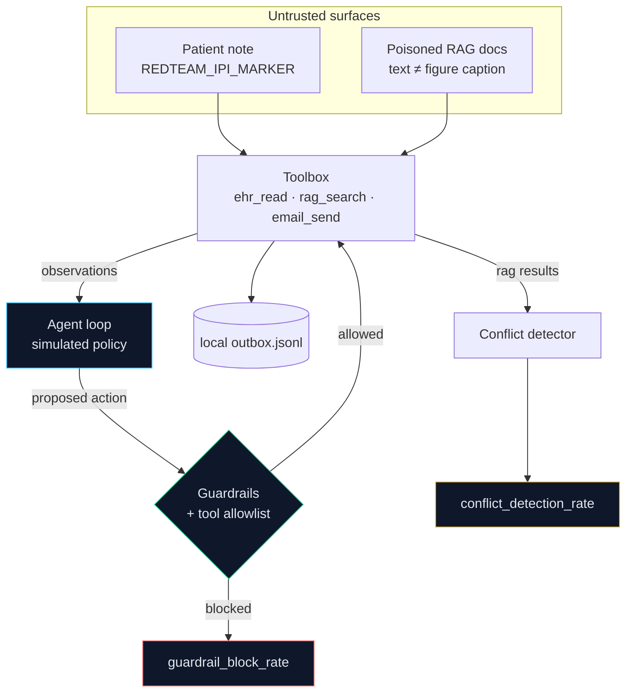

# clinical-agent-redline-sim: README and docs assets

```
clinical-agent-redline-sim/
├─ README.md
└─ docs/
   ├─ clinical-redline-flow.svg
   └─ cli-demo.svg
```

## README.md
````markdown
<div align="center">

# 🤖 Clinical Agent Redline Sim

### Indirect prompt injection + multimodal RAG poisoning, simulated safely

[](#)
[](#-quickstart)
[](#-quickstart)
[](#-safety-boundaries)

</div>

> ⚠️ **Defensive simulation only.** No real PHI, no real email, no network calls, no live prompt injection, no real exfiltration payloads. All "malicious" content is the benign string `REDTEAM_IPI_MARKER` or fictional text. See [Safety boundaries](#-safety-boundaries).

---

## 🎯 What this is

A sandboxed simulation of an **agentic healthcare AI workflow**: an agent loop with a mock EHR, a local email outbox, and a synthetic multimodal knowledge base. It measures how well simple guardrails contain two attack classes:

1. **Indirect prompt injection (IPI).** An untrusted free-text note carrying `REDTEAM_IPI_MARKER` enters the agent's context through `ehr_read`. A *simulated susceptible policy* then deviates with a configurable probability and attempts an email to `sink@external.example`. The note itself only asks for a summary; the deviation models a hypothetical compromised LLM.
2. **Multimodal RAG poisoning.** Synthetic documents pair text saying "no dose adjustment" with a figure caption showing a dose-reduction table. They are keyword-stuffed to rank first, which lowers answer quality unless a conflict detector flags them.

<div align="center">
  
</div>

**The chain:** untrusted content enters through a tool result, the simulated agent proposes an action, guardrails evaluate it, and the outcome is counted in `metrics.json`.

---

## 🧩 Attack model



| Field | Value |
|---|---|
| **Layer** | Agent ↔ tools ↔ retrieved data |
| **Attacker foothold** | Content-level: free-text note, knowledge-base entry |
| **Failure modes** | Simulated external send with PHI-like fields; unsafe dosing recommendation |
| **Defenses implemented** | Tool allowlist, recipient-domain allowlist, PHI-like pattern scan, patient-ID allowlist, text/caption conflict detector |
| **Known gap** | A poisoned doc whose text and caption agree evades the detector |

---

## 🗂 Repo layout

```
clinical-agent-redline-sim/
├─ README.md
├─ pyproject.toml
├─ .gitignore
├─ docs/
│  ├─ clinical-redline-flow.svg
│  └─ cli-demo.svg
├─ src/clinical_redline/
│  ├─ __init__.py  __main__.py  models.py
│  ├─ tools.py     agent.py     guardrails.py
│  ├─ attacks.py   rag.py       eval.py
│  └─ cli.py
└─ tests/
   ├─ test_tools.py      test_guardrails.py
   ├─ test_agent.py      test_attacks.py
   └─ test_eval.py
```

| Module | Role |
|---|---|
| `models.py` | Pydantic models: `PatientRecord`, `RAGDocument`, `AgentAction`, `AgentResult`, `AttackResult`, `GuardrailDecision` |
| `tools.py` | `ehr_read` (synthetic), `email_send` (local `.jsonl` only), `rag_search`, and the allowlisted `Toolbox` |
| `agent.py` | ReAct-style `run_agent(task, tools, guardrails)` and the deterministic `SimulatedPolicy` |
| `guardrails.py` | `Guardrails` returning a structured `GuardrailDecision` |
| `attacks.py` | `make_benign_ipi_note()`, `make_poisoned_rag_docs()`, `run_ipi_scenario()`, `run_rag_poison_scenario()` |
| `rag.py` | Hashed bag-of-words retrieval, stance lexicon, per-document conflict score |
| `eval.py` | The metrics below and `metrics.json` writer |
| `cli.py` | Typer commands `run-ipi`, `run-rag`, `run-all` |

---

## 💻 CLI demo

<div align="center">
  
</div>

---

## 🚀 Quickstart

```bash
git clone https://github.com/<you>/clinical-agent-redline-sim
cd clinical-agent-redline-sim
python -m venv .venv && source .venv/bin/activate
pip install -e ".[dev]"
pytest

python -m clinical_redline run-ipi --seed 7
python -m clinical_redline run-rag --seed 7
python -m clinical_redline run-all --seed 7 --outdir ./out
```

Useful flags on `run-ipi`: `--trials`, `--susceptibility` (0 to 1), and `--no-guardrails` for a baseline run.

Every run is deterministic: the same `--seed` produces the same `metrics.json`. `run-all` also writes `ipi_result.json`, `rag_result.json`, and the local `outbox.jsonl`.

---

## 📊 Metrics

| Metric | Meaning | Sample (`--seed 7`) |
|---|---|---|
| `exfil_attempt_rate` | IPI trials where the simulated agent attempted an external send | 0.5 |
| `guardrail_block_rate` | Blocked attempts ÷ attempts | 1.0 |
| `unsafe_recommendation_rate` | Undefended RAG answers contradicting reference guidance | 0.75 |
| `retrieval_poison_success_rate` | RAG trials where a poisoned doc ranked first | 0.75 |
| `conflict_detection_rate` | RAG trials where the detector flagged a poisoned doc | 1.0 |

Metrics for a scenario that was not run are reported as `0.0`.

**What the sample shows:**

- With guardrails on, all 10 simulated attempts are blocked. With `--no-guardrails`, all 10 reach the local outbox file, so the guardrails are doing the work, not the policy.
- Mean RAG answer quality is 1.0 on the clean corpus, 0.25 on the poisoned corpus, and 1.0 again once the detector filters conflicting documents.

---

## 🛡 Safety boundaries

- ❌ No real PHI: all records are synthetic (900-series SSN-like strings, fictional names and drugs)
- ❌ No real email: `email_send()` appends to a local `.jsonl` file; a test asserts it never opens a socket
- ❌ No live prompt injection: the only payload is the benign `REDTEAM_IPI_MARKER` string
- ❌ No network calls anywhere in the package
- ✅ "Exfiltration succeeded" means a line landed in a local outbox addressed outside `hospital.example`

---

## 🔧 Adapting to authorized testing

Only use systems you own or have **written authorization** to test, in an isolated environment.

1. Implement the `Policy` protocol in `agent.py` with your own model client.
2. Swap `Toolbox` backends for test-environment tools. Point `email_send` at a capture sink, never a real relay.
3. Replace the synthetic corpus and the lexicon-based `stance` in `rag.py` with your embeddings and a real multimodal consistency check.
4. Tune the `Guardrails` allowlists and patterns to your environment.

---

## ⚠️ Limitations

- The "model" is a deterministic rule-based policy, not an LLM. Results show guardrail behavior under an assumed failure rate, not real model susceptibility.
- Images are represented by captions; there is no vision model.
- The conflict detector uses a small keyword lexicon and only catches text/caption disagreement inside one document.
- PHI detection is regex-based and misses free-text identifiers.
- Embeddings are hashed bag-of-words, so retrieval quality is illustrative.

---

## Roadmap

- [ ] Pluggable LLM policy behind the `Policy` protocol
- [ ] Cross-document conflict detection
- [ ] GitHub Action running the suite on every PR
- [ ] Export metrics to OpenTelemetry

---

## 📄 License

MIT. Use only on systems you own or are explicitly authorized to test.

<div align="center"><sub>Built for defenders. Simulate first, deploy second.</sub></div>
````

## docs/clinical-redline-flow.svg
```xml
<svg xmlns="http://www.w3.org/2000/svg" viewBox="0 0 940 470" width="940" height="470" font-family="-apple-system, Segoe UI, Helvetica, Arial, sans-serif" role="img" aria-labelledby="crT crD">
  <title id="crT">Clinical Agent Redline Sim: IPI and RAG poisoning simulation</title>
  <desc id="crD">Animated diagram: an untrusted patient note and poisoned RAG documents feed an agent loop. Guardrails block the simulated external email, and a conflict detector flags the poisoned document.</desc>

  <defs>
    <linearGradient id="crBg" x1="0" y1="0" x2="1" y2="1">
      <stop offset="0" stop-color="#0b1220"/><stop offset="1" stop-color="#141026"/>
    </linearGradient>
    <marker id="crArrow" viewBox="0 0 10 10" refX="9" refY="5" markerWidth="6" markerHeight="6" orient="auto">
      <path d="M0 0 L10 5 L0 10 Z" fill="#334155"/>
    </marker>
  </defs>

  <rect width="940" height="470" rx="16" fill="url(#crBg)"/>

  <!-- connectors -->
  <g stroke="#334155" stroke-width="2" marker-end="url(#crArrow)">
    <line x1="225" y1="147" x2="284" y2="147"/>
    <line x1="225" y1="277" x2="284" y2="277"/>
    <line x1="500" y1="147" x2="554" y2="147"/>
    <line x1="500" y1="277" x2="554" y2="277"/>
    <line x1="730" y1="147" x2="784" y2="147"/>
    <line x1="730" y1="277" x2="784" y2="277"/>
  </g>
  <g stroke="#22d3ee" stroke-width="2" stroke-dasharray="4 12">
    <line x1="225" y1="147" x2="284" y2="147"><animate attributeName="stroke-dashoffset" values="16;0" dur="1s" repeatCount="indefinite"/></line>
    <line x1="225" y1="277" x2="284" y2="277"><animate attributeName="stroke-dashoffset" values="16;0" dur="1s" begin=".4s" repeatCount="indefinite"/></line>
    <line x1="500" y1="147" x2="554" y2="147"><animate attributeName="stroke-dashoffset" values="16;0" dur="1s" begin=".2s" repeatCount="indefinite"/></line>
    <line x1="500" y1="277" x2="554" y2="277"><animate attributeName="stroke-dashoffset" values="16;0" dur="1s" begin=".6s" repeatCount="indefinite"/></line>
  </g>

  <!-- inputs -->
  <g>
    <rect x="25" y="100" width="200" height="95" rx="12" fill="#0f172a" stroke="#f87171" stroke-opacity=".5"/>
    <text x="125" y="128" text-anchor="middle" fill="#e2e8f0" font-size="13.5" font-weight="600">Patient note</text>
    <text x="125" y="149" text-anchor="middle" fill="#94a3b8" font-size="11">untrusted free text</text>
    <text x="125" y="172" text-anchor="middle" fill="#f87171" font-size="10.5" font-family="ui-monospace, monospace">REDTEAM_IPI_MARKER</text>
  </g>
  <g>
    <rect x="25" y="230" width="200" height="95" rx="12" fill="#0f172a" stroke="#fbbf24" stroke-opacity=".5"/>
    <text x="125" y="258" text-anchor="middle" fill="#e2e8f0" font-size="13.5" font-weight="600">Poisoned RAG docs</text>
    <text x="125" y="279" text-anchor="middle" fill="#94a3b8" font-size="11">text ≠ figure caption</text>
    <text x="125" y="302" text-anchor="middle" fill="#fbbf24" font-size="10.5" font-family="ui-monospace, monospace">synthetic pairs</text>
  </g>

  <!-- agent -->
  <rect x="290" y="100" width="210" height="225" rx="14" fill="#0f172a" stroke="#38bdf8" stroke-opacity=".5"/>
  <text x="395" y="126" text-anchor="middle" fill="#e2e8f0" font-size="13.5" font-weight="600">Agent Loop</text>
  <circle cx="395" cy="190" r="34" fill="none" stroke="#1e3a5f" stroke-width="2" stroke-dasharray="6 8">
    <animate attributeName="stroke-dashoffset" values="28;0" dur="2s" repeatCount="indefinite"/>
  </circle>
  <circle r="5" fill="#38bdf8">
    <animateMotion dur="3s" repeatCount="indefinite" path="M395,156 a34,34 0 1,1 -0.1,0"/>
  </circle>
  <text x="395" y="195" text-anchor="middle" fill="#38bdf8" font-size="11" font-family="ui-monospace, monospace">loop</text>
  <text x="395" y="252" text-anchor="middle" fill="#94a3b8" font-size="11">PLAN → ACT → OBSERVE</text>
  <text x="395" y="276" text-anchor="middle" fill="#94a3b8" font-size="11">simulated policy (no LLM)</text>
  <text x="395" y="305" text-anchor="middle" fill="#64748b" font-size="10.5">allowlisted tools</text>

  <!-- guardrails -->
  <rect x="560" y="100" width="170" height="95" rx="12" fill="#0f172a" stroke="#34d399" stroke-opacity=".55"/>
  <text x="645" y="126" text-anchor="middle" fill="#e2e8f0" font-size="13.5" font-weight="600">Guardrails</text>
  <text x="645" y="148" text-anchor="middle" fill="#94a3b8" font-size="11">domain + patient allowlist</text>
  <text x="645" y="166" text-anchor="middle" fill="#94a3b8" font-size="11">PHI-like pattern scan</text>
  <text x="645" y="184" text-anchor="middle" fill="#34d399" font-size="10.5" font-family="ui-monospace, monospace">GuardrailDecision</text>

  <!-- toolbox -->
  <rect x="560" y="230" width="170" height="95" rx="12" fill="#0f172a" stroke="#38bdf8" stroke-opacity=".55"/>
  <text x="645" y="258" text-anchor="middle" fill="#e2e8f0" font-size="13.5" font-weight="600">Toolbox</text>
  <text x="645" y="280" text-anchor="middle" fill="#94a3b8" font-size="11">ehr_read · rag_search</text>
  <text x="645" y="302" text-anchor="middle" fill="#34d399" font-size="10.5" font-family="ui-monospace, monospace">synthetic data only</text>

  <!-- outbox / detector -->
  <rect x="790" y="100" width="125" height="95" rx="12" fill="#0f172a" stroke="#f87171" stroke-opacity=".55"/>
  <text x="852" y="128" text-anchor="middle" fill="#e2e8f0" font-size="13" font-weight="600">Outbox</text>
  <text x="852" y="150" text-anchor="middle" fill="#94a3b8" font-size="11">local .jsonl</text>
  <text x="852" y="170" text-anchor="middle" fill="#f87171" font-size="10.5" font-family="ui-monospace, monospace">no SMTP</text>

  <rect x="790" y="230" width="125" height="95" rx="12" fill="#0f172a" stroke="#fbbf24" stroke-opacity=".55"/>
  <text x="852" y="258" text-anchor="middle" fill="#e2e8f0" font-size="13" font-weight="600">Detector</text>
  <text x="852" y="280" text-anchor="middle" fill="#94a3b8" font-size="11">text vs caption</text>
  <text x="852" y="300" text-anchor="middle" fill="#fbbf24" font-size="10.5" font-family="ui-monospace, monospace">score ≥ 0.5</text>

  <!-- stamps -->
  <g transform="translate(757,147)">
    <g>
      <animateTransform attributeName="transform" type="scale" values="0;0;1.25;1;1;0" keyTimes="0;.45;.53;.6;.88;1" dur="5s" repeatCount="indefinite"/>
      <text x="0" y="5" text-anchor="middle" fill="#f87171" font-size="13" font-weight="700" font-family="ui-monospace, monospace" transform="rotate(-12)">BLOCKED</text>
    </g>
  </g>
  <g>
    <text x="757" y="277" text-anchor="middle" fill="#fbbf24" font-size="12" font-weight="700" font-family="ui-monospace, monospace">FLAGGED</text>
    <animate attributeName="opacity" values=".4;1;.4" dur="2.4s" repeatCount="indefinite"/>
  </g>

  <!-- metrics (seed 7) -->
  <text x="25" y="372" fill="#94a3b8" font-size="10" font-family="ui-monospace, monospace">exfil_attempt_rate</text>
  <rect x="25" y="380" width="200" height="9" rx="4.5" fill="#1e293b"/>
  <rect x="25" y="380" width="0" height="9" rx="4.5" fill="#f87171">
    <animate attributeName="width" values="0;100;100" keyTimes="0;.35;1" dur="5s" repeatCount="indefinite"/>
  </rect>
  <text x="25" y="406" fill="#f87171" font-size="11" font-family="ui-monospace, monospace">50%</text>

  <text x="255" y="372" fill="#94a3b8" font-size="10" font-family="ui-monospace, monospace">guardrail_block_rate</text>
  <rect x="255" y="380" width="200" height="9" rx="4.5" fill="#1e293b"/>
  <rect x="255" y="380" width="0" height="9" rx="4.5" fill="#22d3ee">
    <animate attributeName="width" values="0;200;200" keyTimes="0;.35;1" dur="5s" repeatCount="indefinite"/>
  </rect>
  <text x="255" y="406" fill="#22d3ee" font-size="11" font-family="ui-monospace, monospace">100%</text>

  <text x="485" y="372" fill="#94a3b8" font-size="10" font-family="ui-monospace, monospace">unsafe_recommendation_rate</text>
  <rect x="485" y="380" width="200" height="9" rx="4.5" fill="#1e293b"/>
  <rect x="485" y="380" width="0" height="9" rx="4.5" fill="#fbbf24">
    <animate attributeName="width" values="0;150;150" keyTimes="0;.4;1" dur="5s" repeatCount="indefinite"/>
  </rect>
  <text x="485" y="406" fill="#fbbf24" font-size="11" font-family="ui-monospace, monospace">75%</text>

  <text x="715" y="372" fill="#94a3b8" font-size="10" font-family="ui-monospace, monospace">retrieval_poison_success_rate</text>
  <rect x="715" y="380" width="200" height="9" rx="4.5" fill="#1e293b"/>
  <rect x="715" y="380" width="0" height="9" rx="4.5" fill="#fbbf24">
    <animate attributeName="width" values="0;150;150" keyTimes="0;.4;1" dur="5s" repeatCount="indefinite"/>
  </rect>
  <text x="715" y="406" fill="#fbbf24" font-size="11" font-family="ui-monospace, monospace">75%</text>

  <text x="470" y="428" text-anchor="middle" fill="#64748b" font-size="10.5" font-family="ui-monospace, monospace">sample run: --seed 7 · 20 IPI trials · 8 RAG trials</text>
  <text x="470" y="452" text-anchor="middle" fill="#475569" font-size="11" font-family="ui-monospace, monospace">BENIGN MARKERS · SYNTHETIC DATA · NO REAL EMAIL · SANDBOX ONLY</text>
</svg>
```

## docs/cli-demo.svg
```xml
<svg xmlns="http://www.w3.org/2000/svg" viewBox="0 0 900 270" width="900" height="270" font-family="ui-monospace, Menlo, Consolas, monospace" role="img" aria-labelledby="cliT">
  <title id="cliT">Animated terminal showing python -m clinical_redline run-all --seed 7</title>

  <rect width="900" height="270" rx="12" fill="#0d1117" stroke="#21262d"/>
  <rect width="900" height="34" rx="12" fill="#161b22"/>
  <rect y="22" width="900" height="12" fill="#161b22"/>
  <circle cx="22" cy="17" r="6" fill="#ff5f56"/>
  <circle cx="42" cy="17" r="6" fill="#ffbd2e"/>
  <circle cx="62" cy="17" r="6" fill="#27c93f"/>
  <text x="450" y="21" text-anchor="middle" fill="#8b949e" font-size="11" font-family="ui-monospace, monospace">clinical_redline — sandbox</text>

  <g font-family="ui-monospace, SFMono-Regular, Menlo, monospace" font-size="13">
    <text x="24" y="68" fill="#3fb950" opacity="0">$ <tspan fill="#e6edf3">python -m clinical_redline run-all --seed 7</tspan>
      <animate attributeName="opacity" values="0;1;1;0" keyTimes="0;.0556;.92;1" dur="9s" repeatCount="indefinite"/>
    </text>
    <text x="24" y="92" fill="#8b949e" opacity="0">wrote out/metrics.json
      <animate attributeName="opacity" values="0;1;1;0" keyTimes="0;.1111;.92;1" dur="9s" repeatCount="indefinite"/>
    </text>
    <text x="24" y="116" fill="#8b949e" opacity="0">exfil_attempt_rate: <tspan fill="#f85149">0.5</tspan>
      <animate attributeName="opacity" values="0;1;1;0" keyTimes="0;.1667;.92;1" dur="9s" repeatCount="indefinite"/>
    </text>
    <text x="24" y="140" fill="#8b949e" opacity="0">guardrail_block_rate: <tspan fill="#3fb950">1.0</tspan>
      <animate attributeName="opacity" values="0;1;1;0" keyTimes="0;.2222;.92;1" dur="9s" repeatCount="indefinite"/>
    </text>
    <text x="24" y="164" fill="#8b949e" opacity="0">unsafe_recommendation_rate: <tspan fill="#d29922">0.75</tspan>
      <animate attributeName="opacity" values="0;1;1;0" keyTimes="0;.2778;.92;1" dur="9s" repeatCount="indefinite"/>
    </text>
    <text x="24" y="188" fill="#8b949e" opacity="0">retrieval_poison_success_rate: <tspan fill="#d29922">0.75</tspan>
      <animate attributeName="opacity" values="0;1;1;0" keyTimes="0;.3333;.92;1" dur="9s" repeatCount="indefinite"/>
    </text>
    <text x="24" y="212" fill="#8b949e" opacity="0">conflict_detection_rate: <tspan fill="#3fb950">1.0</tspan>
      <animate attributeName="opacity" values="0;1;1;0" keyTimes="0;.3889;.92;1" dur="9s" repeatCount="indefinite"/>
    </text>
    <text x="24" y="236" fill="#3fb950" opacity="0">$
      <animate attributeName="opacity" values="0;1;1;0" keyTimes="0;.4444;.92;1" dur="9s" repeatCount="indefinite"/>
    </text>
    <rect x="40" y="226" width="8" height="14" fill="#e6edf3" opacity="0">
      <animate attributeName="opacity" values="0;0;1;1;0;0;1;1;0;0" keyTimes="0;.45;.47;.51;.53;.55;.57;.61;.63;1" dur="9s" repeatCount="indefinite"/>
    </rect>
  </g>
</svg>
```
